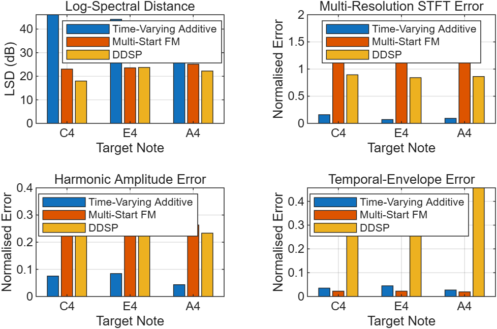
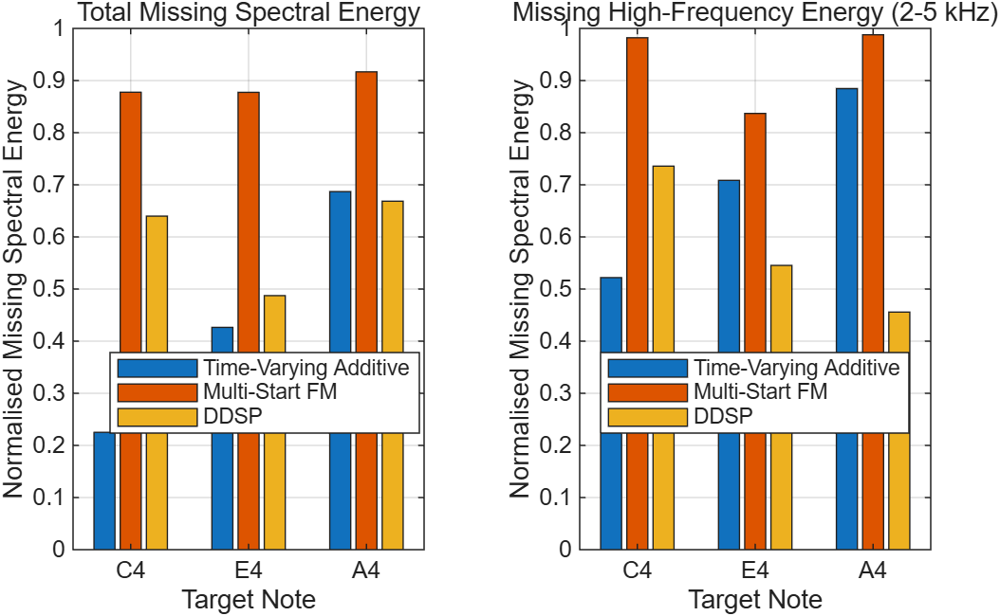
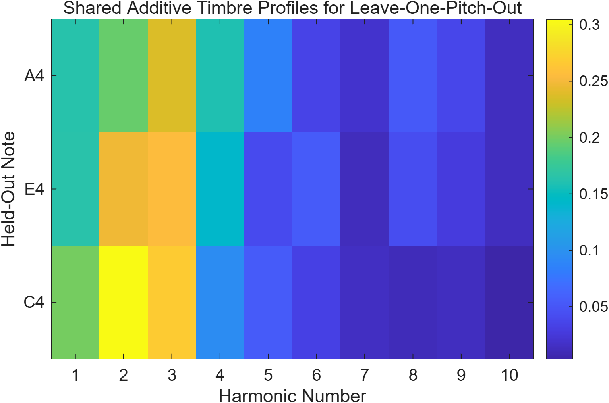
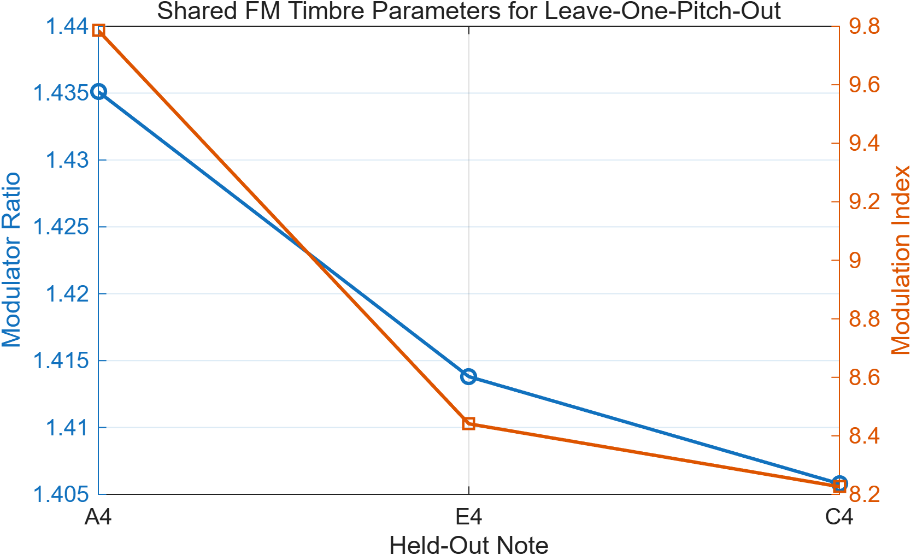
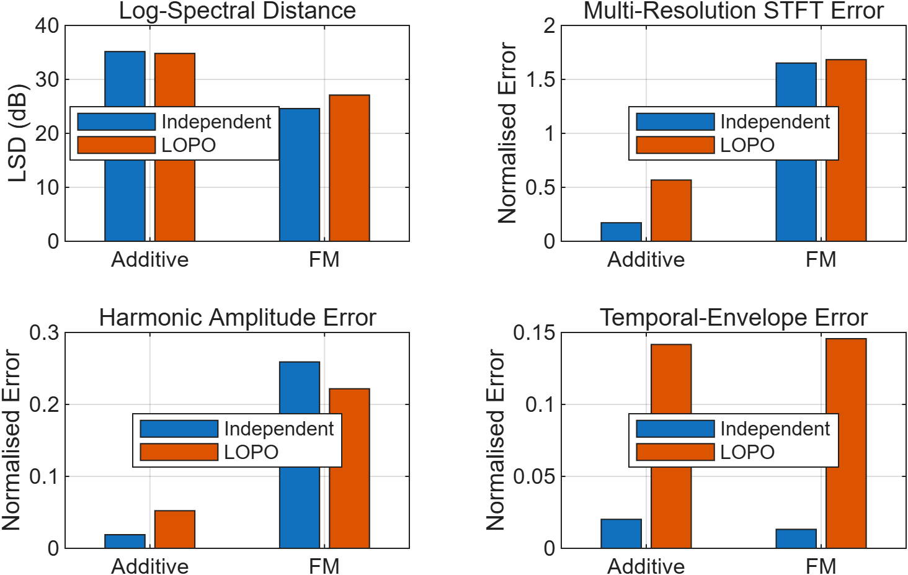

# From Additive and FM Synthesis to DDSP: Modelling Musical Instrument Timbre

## Project Overview

This project investigates musical-instrument timbre modelling using classical and modern synthesis approaches.

The final experiments focus on non-vibrato flute tones at three target pitches:

- C4
- E4
- A4

Three synthesis approaches are compared:

1. **Time-Varying Additive Synthesis**
2. **Constrained Multi-Start Two-Operator FM Synthesis**
3. **Pretrained DDSP Flute Synthesis**

The project examines not only how closely each model reconstructs individual reference tones, but also how well compact timbre parameters transfer across pitch.

---

## Research Question

**How do classical additive and FM synthesis compare with a modern DDSP-based instrument model in reconstructing and transferring musical-instrument timbre across pitch?**

A secondary question is:

**What spectral and temporal information remains in the residual error of compact additive and FM models, and what additional characteristics can be captured by a pretrained DDSP model?**

---

## Signal Analysis

Each flute reference recording was analysed using:

- Time-domain waveform analysis
- Fourier spectrum
- STFT spectrogram
- Harmonic amplitude extraction
- Amplitude-envelope extraction

These measurements were then used to construct and evaluate the classical synthesis models.

---

## Synthesis Models

### Time-Varying Additive Synthesis

The additive model represents each flute tone as a sum of harmonic sinusoids.

Rather than using fixed harmonic amplitudes, the final model tracks the amplitudes of the first ten harmonics over time. This allows the spectral balance of the synthetic tone to evolve throughout the note.

The method therefore provides an explicit and interpretable representation of harmonic structure.

### Multi-Start FM Synthesis

A compact two-operator FM model was used as the second classical baseline.

The final implementation fixes the carrier frequency to the target fundamental frequency and optimises:

- Modulator ratio
- Modulation index

Multiple initial parameter values are tested to reduce sensitivity to local optimisation solutions.

### Pretrained DDSP Flute Model

A pretrained DDSP flute model was evaluated as the modern synthesis baseline.

The DDSP experiment was run in Google Colab using the extracted fundamental-frequency and loudness trajectories of each flute recording.

The original automatic adjustment function shifted the lower flute tone substantially in pitch. Therefore, the final evaluation uses **pitch-preserving inference with automatic adjustment disabled**.

The final DDSP outputs preserve the original C4, E4, and A4 target pitches.

---

# Final Quantitative Evaluation

The three models were evaluated using four complementary reconstruction metrics:

- **Log-Spectral Distance (LSD)**
- **Multi-Resolution STFT Error**
- **Harmonic Amplitude Error**
- **Temporal-Envelope Error**

All synthesis signals were peak-normalised before evaluation so that differences in output gain did not dominate the comparison.

## Three-Model Comparison

### Main Quantitative Findings

The mean Log-Spectral Distance across C4, E4, and A4 was:

| Model | Mean LSD |
|---|---:|
| Time-Varying Additive | 35.1632 dB |
| Multi-Start FM | 24.5580 dB |
| **DDSP** | **22.6958 dB** |

DDSP therefore achieved the lowest overall Log-Spectral Distance.

However, the remaining metrics show that no single model is superior in every aspect of reconstruction.

**Time-Varying Additive synthesis** produced substantially lower Multi-Resolution STFT and Harmonic Amplitude errors, reflecting its explicit modelling of the measured harmonic structure.

**DDSP** achieved a closer overall spectral match, but its temporal-envelope reconstruction differed more strongly from the reference signals.

**Two-Operator FM synthesis** provided a compact parametric baseline but showed larger time-frequency and harmonic reconstruction errors under the current model configuration.

---

# Residual Spectral Analysis

Residual analysis was used to examine spectral information present in the reference signal but not reconstructed by each synthesis model.

Two measurements were considered:

- Total missing spectral energy between 0 and 5 kHz
- Missing high-frequency spectral energy between 2 and 5 kHz

The mean residual results were:

| Model | Total Missing Spectral Energy | Missing 2–5 kHz Energy |
|---|---:|---:|
| **Time-Varying Additive** | **0.4462** | 0.7050 |
| Multi-Start FM | 0.8906 | 0.9357 |
| DDSP | 0.5986 | **0.5790** |

The additive model retained the largest proportion of the overall reference spectral energy.

In contrast, DDSP retained more information in the **2–5 kHz high-frequency region**, particularly for the higher target pitches.

This suggests that the models capture different aspects of flute timbre rather than differing only in overall reconstruction accuracy.

---

# Leave-One-Pitch-Out Timbre Transfer

A Leave-One-Pitch-Out (LOPO) experiment was conducted to test whether timbre parameters derived from two pitches could be transferred to a third unseen pitch.

For each experiment:

- Two flute pitches were used as training/reference notes.
- Their timbre parameters were combined.
- The shared parameters were then used to synthesise the held-out pitch.

Three cases were evaluated:

- C4 + E4 → A4
- C4 + A4 → E4
- E4 + A4 → C4

## Additive Timbre Transfer

For additive synthesis, a shared harmonic profile was estimated from the two available training notes.

## FM Timbre Transfer

For FM synthesis, shared modulator-ratio and modulation-index parameters were estimated from the two training pitches.

## Independent vs LOPO Comparison

The LOPO experiment showed that pitch-independent timbre transfer is more difficult than independently fitting each target note.

The effect was especially clear in temporal-envelope reconstruction and in the Multi-Resolution STFT error of the additive model.

Other metrics changed non-uniformly, showing that timbre transfer performance depends on which aspect of the signal is being measured.

---

# Alignment Check

Before interpreting the final temporal metrics, the reference and synthesized signals were checked for major timing misalignment.

The Additive and FM outputs were found to be closely aligned with the reference recordings.

The DDSP signals did not exhibit a major global timing shift. However, their attack and decay behaviour differed from the reference recordings.

Therefore, the larger DDSP temporal-envelope error is interpreted primarily as a genuine difference in temporal-envelope reconstruction rather than a simple onset-alignment error.

---

# Audio Examples

The following examples allow direct comparison of the final synthesis outputs.

## C4

**Time-Varying Additive**

<audio controls>
  <source src="audio_output/Flute_C4_TimeVarying_Additive.wav" type="audio/wav">
</audio>

**Multi-Start FM**

<audio controls>
  <source src="audio_output/Flute_C4_MultiStart_FM.wav" type="audio/wav">
</audio>

**DDSP**

<audio controls>
  <source src="audio_output/Flute_C4_DDSP.wav" type="audio/wav">
</audio>

---

## E4

**Time-Varying Additive**

<audio controls>
  <source src="audio_output/Flute_E4_TimeVarying_Additive.wav" type="audio/wav">
</audio>

**Multi-Start FM**

<audio controls>
  <source src="audio_output/Flute_E4_MultiStart_FM.wav" type="audio/wav">
</audio>

**DDSP**

<audio controls>
  <source src="audio_output/Flute_E4_DDSP.wav" type="audio/wav">
</audio>

---

## A4

**Time-Varying Additive**

<audio controls>
  <source src="audio_output/Flute_A4_TimeVarying_Additive.wav" type="audio/wav">
</audio>

**Multi-Start FM**

<audio controls>
  <source src="audio_output/Flute_A4_MultiStart_FM.wav" type="audio/wav">
</audio>

**DDSP**

<audio controls>
  <source src="audio_output/Flute_A4_DDSP.wav" type="audio/wav">
</audio>

---

# Main Findings

The experiments demonstrate that the three synthesis approaches capture different aspects of flute timbre.

### Time-Varying Additive Synthesis

- Provides an interpretable harmonic representation.
- Reconstructs measured harmonic-amplitude structure accurately.
- Achieves low Multi-Resolution STFT and harmonic-amplitude errors.
- Retains the largest proportion of overall reference spectral energy.

### Multi-Start FM Synthesis

- Provides a compact parametric representation.
- Multi-start optimisation reduces dependence on a single initial solution.
- Produces reasonable overall spectral similarity.
- The restricted two-operator structure limits detailed harmonic and time-frequency reconstruction.

### DDSP

- Produces the lowest mean Log-Spectral Distance.
- Captures additional high-frequency spectral characteristics.
- Preserves target pitch when automatic adjustment is disabled.
- Shows larger differences in attack, decay, and temporal-envelope structure.

Overall, the results show that **no single synthesis approach is uniformly superior**.

Explicit classical models are strong when reconstructing measured and interpretable signal structure, while the pretrained DDSP model captures broader spectral characteristics that are not fully represented by the compact classical models.

---

# Project Files

The main implementation files are:

- [`flute_analysis_01.mlx`](flute_analysis_01.mlx) — flute analysis and classical synthesis
- [`final_evaluation_02.mlx`](final_evaluation_02.mlx) — quantitative evaluation, LOPO and residual analysis
- [`ddsp_timbre_transfer.ipynb`](ddsp_timbre_transfer.ipynb) — pretrained DDSP flute experiment
- [`audio_output/`](audio_output/) — synthesized audio
- [`results/`](results/) — preliminary figures
- [`results_02/`](results_02/) — final quantitative results

The original proposal is also available:

[**ELEC5305 Project Proposal**](ELEC5305_Project_Proposal_ZhanXu.pdf)

---

# Repository

[**View the GitHub Repository**](https://github.com/zhxu0930-cmd/elec5305-project-550439255)

---

## Project Status

**Final implementation and quantitative evaluation completed.**
